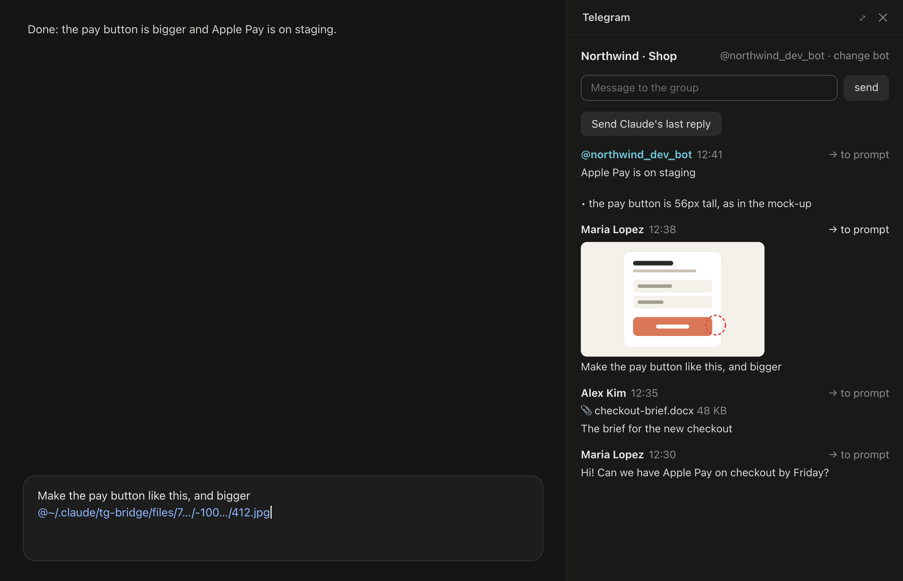
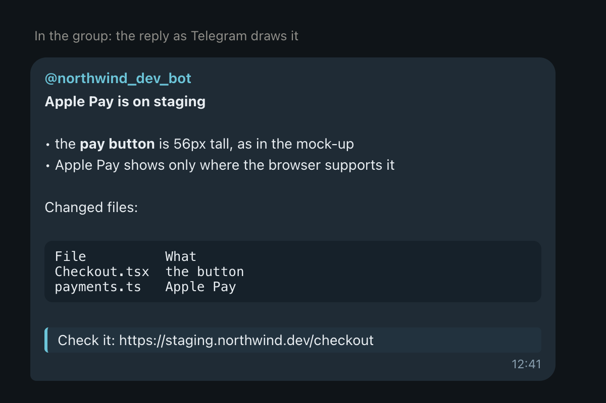
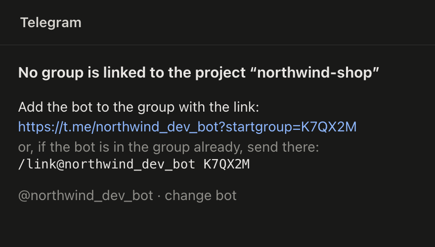

# Claude Telegram — your project's Telegram group, next to Claude

**English** · [Русский](docs/README.ru.md)



A mod for the **Code tab of Claude Desktop** (macOS) that puts the Telegram group of a project in a pane beside the session, so the talk with a client or a team and the work with Claude are in one window:

- **One group per project.** `/tg-link` ties a group to the project folder; every session of that project, a git worktree or a subfolder included, opens the pane by itself.
- **Messages into the prompt.** **→ to prompt** puts a message's text into Claude's prompt box as it was written: no author, no quote marks.
- **Pictures and files too.** Pictures show as previews; files (md, docx, pdf, …, up to 20 MB) as 📎 name and size. **→ to prompt** downloads one and puts it in as an `@` mention of the file, which Claude opens.
- **Claude's replies into the group, formatted.** **Send Claude's last reply** turns Claude's Markdown into what Telegram draws: bold, italic, code blocks, links, quotes; headings bold, lists with bullets, tables lined up in a monospace block. A long reply goes as several messages, cut between blocks.
- **Your own words too.** The field at the top sends what you type to the group, as typed.
- **Any bot.** Paste a bot's token in the pane and switch bots any time; each bot keeps its own group links.
- **Speaks your language**: English or Русский, following Claude Desktop's own language setting; English for every other language.

It is built on Claude Code's **mods** (plugins of function hooks), so it does not patch the Claude app: updates of Claude don't break it, and removing the plugin removes it. It talks to Telegram through the **Bot API**, with a bot you make yourself.

<p>
  
  
</p>

<sub>A demo group. The words and the formatting come from the mod's own code; [docs/demo/render.ts](docs/demo/render.ts) renders these pictures.</sub>

## Requirements

- **macOS** and **Claude Desktop** with mods support (Claude Code engine 2.1.289 or later).
- A **Telegram bot** of your own (free, made with [@BotFather](https://t.me/BotFather)) and a group you can add it to.
- `curl` and `git` (part of macOS; `git` comes with the Command Line Tools).
- The mod draws in Claude Desktop's Code tab. It also loads in the terminal `claude`, where it draws a simpler text version without picture previews.

## Install

### From the marketplace (recommended)

```bash
claude plugin marketplace add tripolskiydigital/claude-telegram
```

```bash
claude plugin install tg-bridge@claude-telegram
```

Then open a new session in Claude Desktop (or quit Claude with ⌘Q and open it again for sessions that were already open). To update later:

```bash
claude plugin update tg-bridge@claude-telegram
```

### From a clone

```bash
git clone https://github.com/tripolskiydigital/claude-telegram.git ~/claude-telegram
```

Then add the folder to `env` in `~/.claude/settings.json` (several folders are separated with `:`):

```json
{
  "env": {
    "CLAUDE_CODE_PLUGIN_DIRS": "/Users/you/claude-telegram"
  }
}
```

Use one way or the other, not both: with both, the mod loads twice.

## Setting it up

1. **Make a bot.** In Telegram, open [@BotFather](https://t.me/BotFather), send `/newbot` and follow it; it gives you a token like `123456789:AA…`.
2. **Let the bot read the group.** In @BotFather: `/setprivacy` → your bot → **Disable**. Without it a bot sees only commands addressed to it (making the bot an admin of the group works too). If the bot is in the group already, remove it and add it again after the change.
3. **Paste the token.** In Claude Desktop, type `/tg`: the pane opens and asks for the token. Paste it and press Enter; the mod checks it with Telegram. The token serves every project; **@bot · change bot** at the top of the pane swaps it later.
4. **Link the group.** In a session of the project, type `/tg-link`. It gives a code, valid for 30 minutes, and two ways to use it: the link `https://t.me/<bot>?startgroup=<code>` adds the bot to a group you pick and links it; for a group the bot is in already, send `/link@<bot> <code>` there. The bot answers in the group, and the pane shows its messages.

From then on the pane opens by itself in every session of the project (the `autoOpen` option turns that off).

## Using it

- **→ to prompt** on a message puts its text at the cursor in the prompt box; a picture or a file is downloaded and put in as `@~/.claude/tg-bridge/files/…`. Write your own words around it and send it to Claude as usual.
- **Send Claude's last reply** sends Claude's latest answer of the session to the group, formatted. `/tg-send` does the same; `/tg-send <text>` sends the text as typed.
- The field at the top sends what you type to the group as typed: no Markdown is read, so a `*` stays a `*`.
- `/tg` opens the pane if you closed it; `/tg-unlink` unlinks the project from its group.

New messages show within about 3 seconds, newest first.

## How it works

| What | How |
| --- | --- |
| Reading the group | the Bot API's `getUpdates`, every 3 seconds. One session at a time polls (it holds a lease in the plugin's store) and keeps every group's messages there; every session reads its own group's from the store |
| Which group a session sees | the session's project folder: for a git worktree the main checkout's (`git rev-parse --git-common-dir`); a subfolder takes the nearest linked folder above it |
| Linking | `/tg-link` keeps a code with the folder that asked; the group that sends it back (as `/start <code>` when the bot is added through the link, or `/link <code>`) is linked to that folder |
| Pictures and files | `getFile`, then `curl` downloads the file to `~/.claude/tg-bridge/files/<bot>/<group>/`. Previews are Telegram's ~320 px copies of the 20 newest pictures |
| Formatting | Claude's Markdown is converted to Telegram's HTML (`parse_mode: HTML`) in the mod; if Telegram refuses a piece, the same piece goes as plain text |
| Interface language | the `locale` field of `~/Library/Application Support/Claude/config.json`, picked out by `grep`: the mod never reads the file itself, which also holds account data |

## What the mod reads, writes and runs

**What the mod sends, and where.** Only to **api.telegram.org**, with your bot's token: requests for the bot's new messages and for the files you put into the prompt (and the previews of pictures), and the messages you send: your typed text and the Claude replies you choose to send. Nothing is sent by itself: a reply leaves only when you press the button or run `/tg-send`. No other service is asked.

**Reads**

- The bot's updates for the groups it is in.
- Claude's final answer of each turn (`turn.complete`) and, in a session resumed before any turn, its last assistant message (`$.session.messages`), only to send it when you ask.
- The `locale` field of Claude Desktop's settings, through `grep` (see the table above).
- The environment variable `HOME`.

**Writes**

- The plugin store that Claude Code keeps for every plugin: the bot token, and per bot its name, the poll position, the folder → group links, pending link codes and the last 200 messages of each group.
- Downloaded pictures and files, under `~/.claude/tg-bridge/files/`.
- The prompt box, only when you press **→ to prompt**.

**Runs** three programs, each by name; nothing it downloads is ever run:

| Program | Arguments | When | Why |
| --- | --- | --- | --- |
| `curl` | `-sSfL --create-dirs -o <file>` and the file's Telegram address | a picture needs a preview, or you press **→ to prompt** on a picture or a file | downloads it; a preview is read back as an image, never run |
| `git` | `-C <folder> rev-parse --path-format=absolute --git-common-dir` | at session start | finds the project a git worktree belongs to |
| `grep` | `-o -m 1` and a pattern for `"locale"`, in Claude Desktop's `config.json` | at session start | picks out the interface language without the mod reading the file |

**Hooks**

- `session.start`: reads the language and the project, registers the commands and starts the 3-second poll.
- `command.run` for its own commands `/tg`, `/tg-link`, `/tg-unlink` and `/tg-send`.
- `turn.complete`: keeps Claude's answer to send it when asked; changes nothing.
- `ui.render` for the mod's own pane.

The mod adds no tools or agents for Claude, and changes nothing Claude reads unless you put a message into the prompt yourself.

## Limits

- **Groups only.** A bot can't read private chats, and it sees a group only after it is added there.
- **Files up to 20 MB**: the Bot API lets a bot download no more.
- **A bot with a webhook** (used by another service) can't be polled; the pane says so. Give the mod a bot of its own.
- Telegram has no headings or tables: headings become bold lines, tables a monospace block.
- Stickers, voice and video messages show as a sign (🎤, 🎬, …) and are not downloaded.

## Uninstall

```bash
claude plugin uninstall tg-bridge@claude-telegram
```

The token, links and messages go with the plugin's store. Downloaded files stay in `~/.claude/tg-bridge/files/`; delete that folder if you don't need them. The bot stays in Telegram: remove it from the group, or delete it in @BotFather.

## Development

```bash
claude plugin validate .
```

```bash
claude plugin test .
```

The module is `hooks/register.tsx`, helpers (Telegram's messages, the Markdown → HTML converter) are in `hooks/lib.ts`, translations in `hooks/i18n.ts`, the state contract in `types/index.d.ts`. The types of the mod API are written by Claude Code into `.claude-plugin/types/` when it loads the plugin. The README's pictures and the plugin's icon are rendered by `node docs/demo/render.ts` (Node 23.6+ and Google Chrome). To iterate with hot reload, ask Claude in a Code session to work on the mod with the `plugin-authoring` skill, pointing the session's mods folder at your clone.

Issues and pull requests are welcome.

Telegram is a trademark of its owner. This mod is not made or endorsed by Telegram; it uses the public Bot API.

## License

[Apache 2.0](LICENSE)
