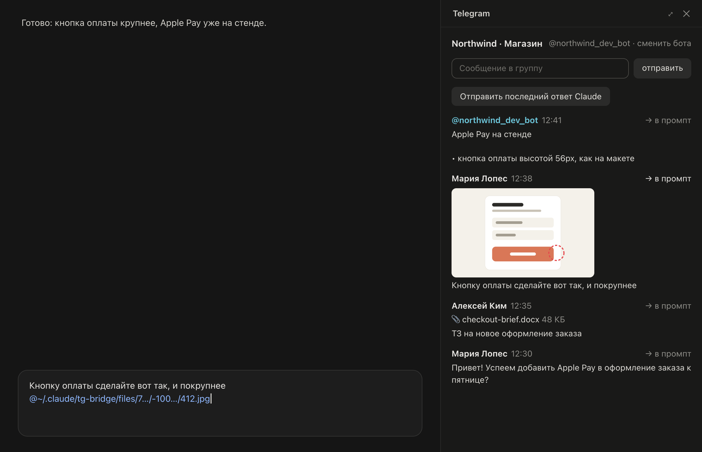
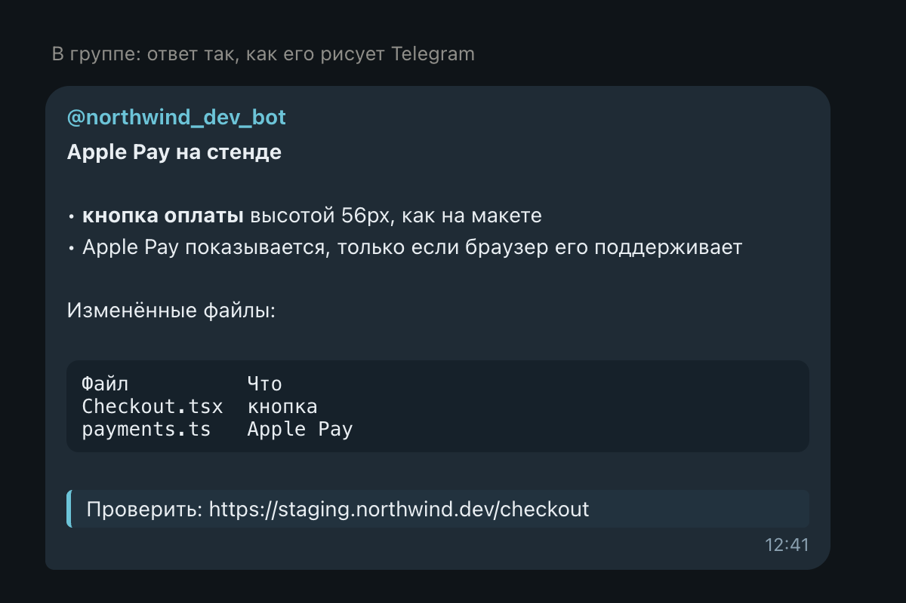
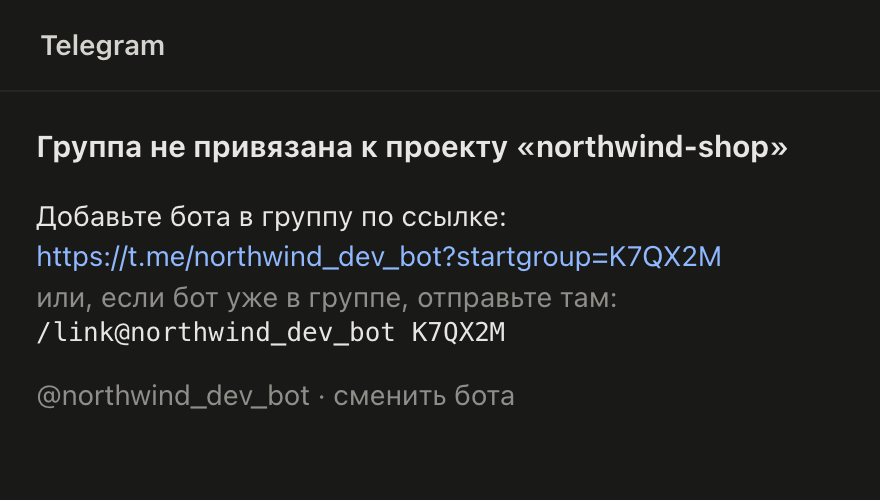

# Claude Telegram — Telegram-группа проекта рядом с Claude

[English](../README.md) · **Русский**



Мод для **вкладки Code в Claude Desktop** (macOS): Telegram-группа проекта — в панели рядом с сессией, так что переписка с клиентом или командой и работа с Claude в одном окне.

- **Одна группа на проект.** `/tg-link` привязывает группу к папке проекта; в каждой сессии этого проекта, включая git-worktree и подпапки, панель открывается сама.
- **Сообщения — в промпт.** **→ в промпт** вставляет текст сообщения в поле ввода Claude как есть: без автора и без знаков цитаты.
- **Картинки и файлы тоже.** Картинки видны превью, файлы (md, docx, pdf, …, до 20 МБ) — как 📎 имя и размер. **→ в промпт** скачивает их и вставляет `@`-упоминанием файла, которое Claude открывает.
- **Ответы Claude — в группу, с форматированием.** **Отправить последний ответ Claude** переводит Markdown Claude в то, что рисует Telegram: жирный, курсив, блоки кода, ссылки, цитаты; заголовки — жирной строкой, списки — с `•`, таблицы — выровненным моноширинным блоком. Длинный ответ уходит несколькими сообщениями, разрезанными между блоками.
- **И свои слова.** Поле сверху отправляет в группу набранный текст как есть.
- **Любой бот.** Токен бота вставляется в панели, бота можно сменить в любой момент; привязки групп у каждого бота свои.
- **Говорит на твоём языке**: English или Русский — по языку самого Claude Desktop; для остальных языков — английский.

Мод построен на **модах** Claude Code (плагинах из функций-хуков), поэтому не патчит приложение Claude: обновления Claude его не ломают, а удаление плагина удаляет его целиком. С Telegram он общается через **Bot API** — с ботом, которого ты создаёшь сам.

<p>
  
  
</p>

<sub>Демо-группа. Слова и форматирование берутся из кода самого мода; картинки рендерит [docs/demo/render.ts](demo/render.ts).</sub>

## Что нужно

- **macOS** и **Claude Desktop** с поддержкой модов (движок Claude Code 2.1.289 или новее).
- Свой **Telegram-бот** (бесплатно, через [@BotFather](https://t.me/BotFather)) и группа, в которую его можно добавить.
- `curl` и `git` (есть в macOS; `git` — в составе Command Line Tools).
- Мод рисует во вкладке Code в Claude Desktop. В терминальном `claude` он тоже загружается и рисует упрощённую текстовую версию, без превью картинок.

## Установка

### Из маркетплейса (рекомендуется)

```bash
claude plugin marketplace add tripolskiydigital/claude-telegram
```

```bash
claude plugin install tg-bridge@claude-telegram
```

Затем открой новую сессию в Claude Desktop (или закрой Claude через ⌘Q и открой снова — для уже открытых сессий). Обновить потом:

```bash
claude plugin update tg-bridge@claude-telegram
```

### Из клона

```bash
git clone https://github.com/tripolskiydigital/claude-telegram.git ~/claude-telegram
```

Затем добавь папку в `env` в `~/.claude/settings.json` (несколько папок разделяются `:`):

```json
{
  "env": {
    "CLAUDE_CODE_PLUGIN_DIRS": "/Users/you/claude-telegram"
  }
}
```

Используй один способ, не оба: при обоих мод загрузится дважды.

## Настройка

1. **Создай бота.** В Telegram открой [@BotFather](https://t.me/BotFather), отправь `/newbot` и следуй подсказкам; он выдаст токен вида `123456789:AA…`.
2. **Разреши боту читать группу.** В @BotFather: `/setprivacy` → твой бот → **Disable**. Без этого бот видит только адресованные ему команды (можно и сделать бота админом группы). Если бот уже в группе — удали его и добавь заново после смены настройки.
3. **Вставь токен.** В Claude Desktop набери `/tg`: панель откроется и попросит токен. Вставь его и нажми Enter — мод проверит его в Telegram. Токен общий для всех проектов; **@бот · сменить бота** вверху панели меняет его позже.
4. **Привяжи группу.** В сессии проекта набери `/tg-link`. Команда выдаст код, действующий 30 минут, и два способа: ссылка `https://t.me/<бот>?startgroup=<код>` добавляет бота в выбранную группу и привязывает её; если бот уже в группе — отправь там `/link@<бот> <код>`. Бот ответит в группе, а панель покажет её сообщения.

Дальше панель открывается сама в каждой сессии проекта (опция `autoOpen` это выключает).

## Как пользоваться

- **→ в промпт** у сообщения вставляет его текст в поле ввода на место курсора; картинка или файл скачиваются и вставляются как `@~/.claude/tg-bridge/files/…`. Допиши свои слова и отправь Claude как обычно.
- **Отправить последний ответ Claude** отправляет в группу последний ответ Claude в этой сессии, с форматированием. `/tg-send` делает то же; `/tg-send <текст>` отправляет текст как набран.
- Поле сверху отправляет в группу набранный текст как есть: Markdown не разбирается, так что `*` остаётся `*`.
- `/tg` открывает панель, если её закрыли; `/tg-unlink` отвязывает проект от группы.

Новые сообщения появляются примерно за 3 секунды, свежие сверху.

## Как это устроено

| Что | Как |
| --- | --- |
| Чтение группы | `getUpdates` из Bot API раз в 3 секунды. Опрашивает одна сессия за раз (она держит аренду в хранилище плагина) и складывает туда сообщения всех групп; каждая сессия читает из хранилища сообщения своей группы |
| Какую группу видит сессия | по папке проекта сессии: для git-worktree — по основной копии (`git rev-parse --git-common-dir`); подпапка берёт ближайшую привязанную папку выше |
| Привязка | `/tg-link` запоминает код вместе с папкой, которая его запросила; группа, которая вернёт код (как `/start <код>` при добавлении бота по ссылке или `/link <код>`), привязывается к этой папке |
| Картинки и файлы | `getFile`, затем `curl` скачивает файл в `~/.claude/tg-bridge/files/<бот>/<группа>/`. Превью — копии Telegram шириной ~320 px для 20 последних картинок |
| Форматирование | Markdown Claude переводится в HTML Telegram (`parse_mode: HTML`) внутри мода; если Telegram не примет кусок, тот же кусок уходит обычным текстом |
| Язык интерфейса | поле `locale` в `~/Library/Application Support/Claude/config.json`, которое достаёт `grep`: сам файл, где лежат и данные аккаунта, мод не читает |

## Что мод читает, пишет и запускает

**Что мод отправляет и куда.** Только на **api.telegram.org**, с токеном твоего бота: запросы новых сообщений бота и файлов, которые ты вставляешь в промпт (и превью картинок), и отправляемые сообщения — набранный тобой текст и ответы Claude, которые ты сам решил отправить. Сам по себе мод ничего не отправляет: ответ уходит, только когда ты нажмёшь кнопку или выполнишь `/tg-send`. Других сервисов мод не спрашивает.

**Читает**

- Обновления бота по группам, в которых он состоит.
- Финальный ответ Claude каждого хода (`turn.complete`) и, в возобновлённой сессии до первого хода, её последнее сообщение ассистента (`$.session.messages`) — только чтобы отправить его по твоей просьбе.
- Поле `locale` из настроек Claude Desktop через `grep` (см. таблицу выше).
- Переменную окружения `HOME`.

**Пишет**

- Хранилище плагина, которое Claude Code ведёт для каждого плагина: токен бота и по каждому боту его имя, позицию опроса, привязки папка → группа, ожидающие коды привязки и последние 200 сообщений каждой группы.
- Скачанные картинки и файлы — в `~/.claude/tg-bridge/files/`.
- Поле ввода — только когда ты нажимаешь **→ в промпт**.

**Запускает** три программы, каждую по имени; ничего скачанного мод не запускает:

| Программа | Аргументы | Когда | Зачем |
| --- | --- | --- | --- |
| `curl` | `-sSfL --create-dirs -o <файл>` и адрес файла в Telegram | картинке нужно превью или ты нажал **→ в промпт** у картинки или файла | скачивает его; превью читается обратно как изображение и не запускается |
| `git` | `-C <папка> rev-parse --path-format=absolute --git-common-dir` | при старте сессии | находит проект, к которому относится git-worktree |
| `grep` | `-o -m 1` и шаблон для `"locale"` в `config.json` Claude Desktop | при старте сессии | достаёт язык интерфейса, не давая моду читать файл |

**Хуки**

- `session.start`: определяет язык и проект, регистрирует команды и запускает опрос раз в 3 секунды.
- `command.run` для своих команд `/tg`, `/tg-link`, `/tg-unlink` и `/tg-send`.
- `turn.complete`: запоминает ответ Claude, чтобы отправить его по просьбе; ничего не меняет.
- `ui.render` для собственной панели мода.

Мод не добавляет Claude инструментов и агентов и не меняет того, что читает Claude, — если только ты сам не вставишь сообщение в промпт.

## Ограничения

- **Только группы.** Бот не читает личные переписки и видит группу только после того, как его туда добавили.
- **Файлы до 20 МБ**: больше Bot API скачивать боту не даёт.
- **Бот с webhook** (которым пользуется другой сервис) опрашивать нельзя; панель об этом скажет. Заведи для мода отдельного бота.
- В Telegram нет заголовков и таблиц: заголовки становятся жирными строками, таблицы — моноширинным блоком.
- Стикеры, голосовые и видео показываются значком (🎤, 🎬, …) и не скачиваются.

## Удаление

```bash
claude plugin uninstall tg-bridge@claude-telegram
```

Токен, привязки и сообщения уходят вместе с хранилищем плагина. Скачанные файлы остаются в `~/.claude/tg-bridge/files/` — удали папку, если они не нужны. Бот остаётся в Telegram: удали его из группы или в @BotFather.

## Разработка

```bash
claude plugin validate .
```

```bash
claude plugin test .
```

Модуль — `hooks/register.tsx`, помощники (сообщения Telegram, конвертер Markdown → HTML) — в `hooks/lib.ts`, переводы — в `hooks/i18n.ts`, контракт состояния — в `types/index.d.ts`. Типы API модов Claude Code записывает в `.claude-plugin/types/` при загрузке плагина. Картинки README и иконку плагина рендерит `node docs/demo/render.ts` (Node 23.6+ и Google Chrome). Чтобы править с горячей перезагрузкой, попроси Claude в сессии Code поработать над модом со скиллом `plugin-authoring`, указав папку модов сессии на свой клон.

Issues и pull requests приветствуются.

Telegram — товарный знак своего владельца. Мод не создан и не одобрен Telegram; он использует публичный Bot API.

## Лицензия

[Apache 2.0](../LICENSE)
